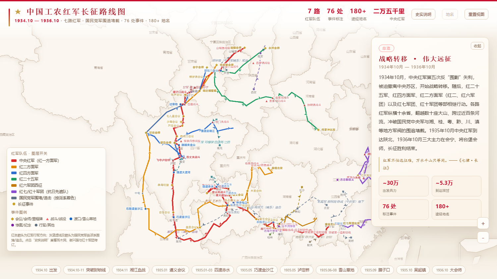
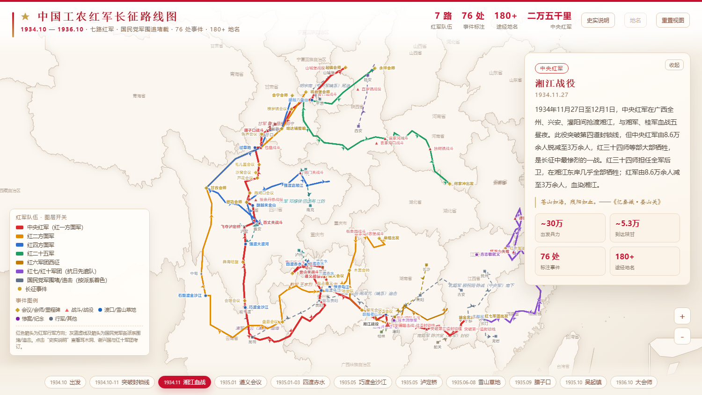
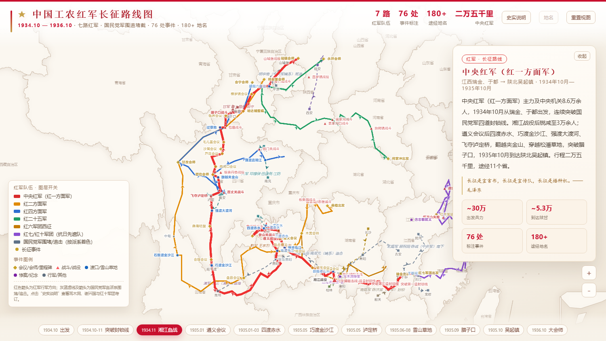
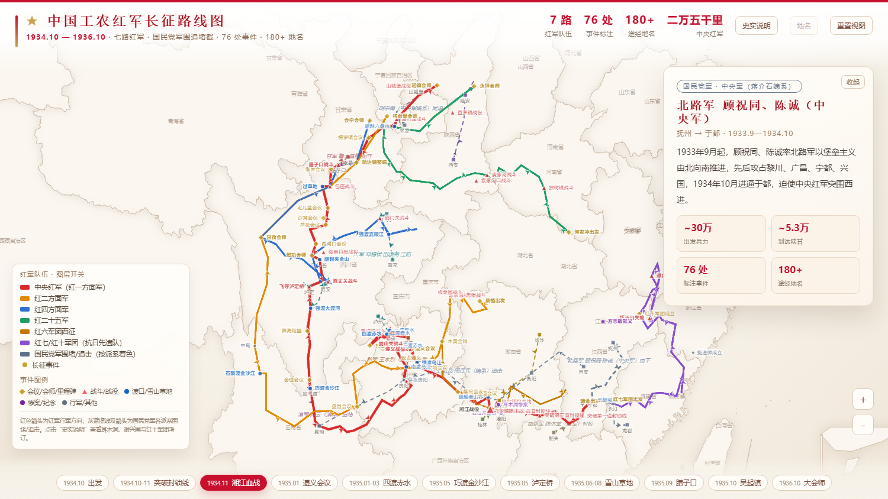
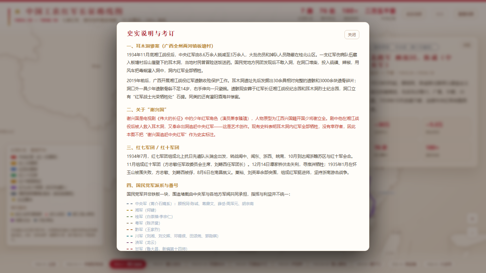
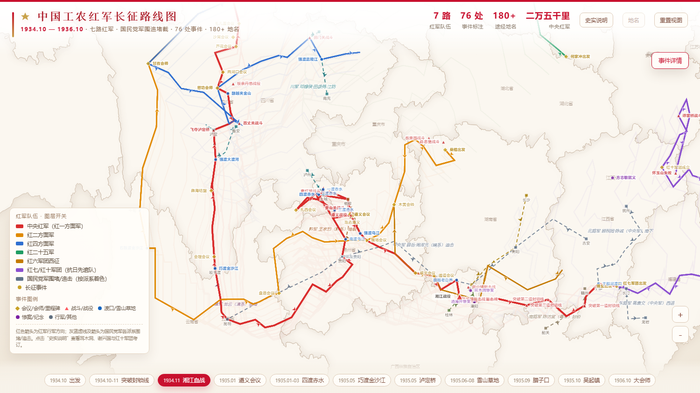

# 中国工农红军长征路线图

> 地图把一条线摊开，我们才看见：所谓战略转移，是在无数个岔路口上，一次次选择还能往哪里走。

一张可以点击、可以放大、可以追问的长征地图。它不只画“走了哪些省”，也画出了队伍的分合、地方军阀的算计，以及那些没有走到终点的人。

**[在线访问](https://night-ci.github.io/Long-March/)** · [本地打开](#本地运行) · [史实与考订](#史实与考订)



---

## 为什么做这张图

教科书里的长征，常常是一条从瑞金到陕北的红色箭头。可一旦把它放回真实的地形与势力范围，那条线会不断分叉、折返、消失又出现。

湘江战役之后，中央红军从 8.6 万余人锐减到 3 万余人。地图上，这只是广西东北角的一小段；但对当时的人来说，那是整整一代人的伤亡。遵义会议也不是“胜利的起点”，而是一次在绝境中调整方向的选择——此后的四渡赤水，在地图上是一团来回穿插的线，来回本身就是目的：在数十万敌军的缝隙里，寻找一条还能走的路。

地图还会提醒我们：国民党军并不是一块铁板。中央军追得最紧，粤军陈济棠选择“借道”，桂军白崇禧力求自保、侧击“送客”，黔军、川军、滇军各守家门，甘军鲁大昌扼守腊子口，东北军、西北军、马家军又在陕甘各有盘算。围追堵截既是军事行动，也是各方利益的博弈。

还有那些不在主线上的人。湘江战役后，百余名红军伤病员藏进广西全州两河镇板塘村的耳木洞，村民冒险送粮，敌人用硫磺和辣椒燃烟灌洞，无一生还。2019 年遗骸收殓，出土 30 余具遗骸、3000 余块碎骨，其中一名不足 14 岁的少年，右手伸向一只瓷碗。地图上，这只是一个小点；但它和瑞金、遵义、吴起一样，都是长征的一部分。

---

## 地图上有什么

- **七路红军**：中央红军（红一方面军）、红二方面军、红四方面军、红二十五军、红六军团西征、红七军团/红十军团（北上抗日先遣队）。
- **76 处事件**：会议、战斗、渡口、雪山草地、惨案与纪念地，每处都有时间、经过与结果。
- **180 余处途经地名**：从瑞金、于都到皎平渡、安顺场、泸定桥、腊子口、哈达铺、吴起镇。
- **国民党军 14 条路线**：按派系着色，标注部队番号、起止地点、行动方向与结局。
- **可点击的路线**：点击任意红军或国民党路线，右侧会显示“从哪里出发、经过哪里、如何结束”。
- **史实考订**：耳木洞惨案、酒海井惨案、“谢兴国”人物辨析、红十军团始末。

---

## 怎么看

1. **点击事件点**：右侧浮窗显示该事件的背景、经过与结果，并附一条与事件相关的引文。
2. **点击路线**：红色实线为红军，灰蓝虚线为国民党军；点击后查看该路线的起点、终点、时间与大致经过。
3. **点击底部时间轴**：快速定位到湘江、遵义、四渡赤水、泸定桥、腊子口、会师等关键节点。
4. **左侧图例**：可单独开关每一支红军队伍、国民党军路线与事件图层。
5. **“地名”按钮**：显示或隐藏 180 余处途经地名。
6. **缩放**：滚轮或右下角 ＋/－，最大可放大 60 倍，密集处放大后可以逐条读清。
7. **“史实说明”**：查看耳木洞、谢兴国、红十军团与底图精度的说明。

### 事件详情



### 红军路线详情



### 国民党军路线详情



### 史实说明与考订



### 放大后的细节



---

## 几个可以带着看的问题

- 湘江之后，中央红军为什么改向贵州？通道、黎平、猴场三次会议，各自改变了什么？
- 四渡赤水在图上是一团来回的线。来回本身是目的吗？如果不是，它在争取什么？
- 同一张地图上，为什么中央军、粤军、桂军、川军、滇军对红军的态度并不相同？
- 从瑞金出发时的 8.6 万人，到吴起镇时只剩 7000 余人。地图上的每一条线，具体意味着多少人的命运？
- 耳木洞不属于任何一场战役，却是一群掉队者的全部结局。历史应该如何记录没有留下姓名的人？

---

## 史实与考订

**耳木洞惨案**：1934 年 11 月底湘江战役后，一支红军伤病队伍藏入广西全州两河镇板塘村后山崖壁下的耳木洞。村民曾冒险送饭送药；国民党地方民团发现后不敢入洞，在洞口堆柴，投入硫磺、辣椒，用风车将毒烟灌入，洞内红军全部牺牲。2019 年前后遗骸收殓，发掘出 30 余具相对完整的遗骸和 3000 余块遗骨碎片；洞口外一具少年遗骸骨龄不足 14 岁，右手伸向一只瓷碗。遗骸现安葬于红军长征湘江战役纪念园和耳木洞烈士纪念园。

**关于“谢兴国”**：谢兴国是电视剧《伟大的长征》中的少年红军角色，人物原型为江西兴国籍开国少将谢立全。剧中他在湘江战役后入耳木洞、又奉命出洞追赶中央红军，属于艺术创作。现有史料表明耳木洞内红军全部牺牲，没有幸存者，因此本图不把“谢兴国追赶中央红军”作为史实标注。

**红七军团 / 红十军团**：1934 年 7 月，红七军团组成北上抗日先遣队从瑞金出发，转战闽中、闽东、浙西、皖南；11 月与红十军组成红十军团。12 月谭家桥战斗失利，1935 年 1 月怀玉山失败，方志敏、刘畴西被俘，8 月 6 日在南昌就义；粟裕、刘英率余部突围，组成红军挺进师，坚持浙南游击战争。

**精度说明**：底图为省级行政区。路线与地名依据公开党史、地方志资料落点，部分乡镇、村落地名采用示意坐标；国民党军围堵、追击路线为示意走向，非精确 GPS 轨迹。乡镇级行政界线没有公开数据，事件点按乡镇/村旧址落点示意。

---

## 数据与来源

- 底图：阿里云 DataV 中国地图 GeoJSON（省级行政区，含南海诸岛）。
- 路线与事件：中国国家博物馆长征展、共产党员网、人民日报、地方党史与文旅资料、百度百科相关词条等。
- 国民党军派系与番号：公开党史、军史资料。
- 引文：毛泽东诗词与著作，方志敏《可爱的中国》《清贫》等。

史料繁杂，错误难免。尤其地方事件、乡镇地名与国民党军番号，欢迎通过 Issue 或 PR 指正。

---

## 技术说明

- 纯静态单页：HTML + 原生 JavaScript + ECharts 5，无构建、无后端。
- 地图与依赖全部本地化，断网也能打开。
- 文件结构：

```
.
├── index.html          # 页面、样式与数据
├── echarts.min.js      # ECharts 5
├── china-geo.js        # 中国省级行政区 GeoJSON
├── screenshots/        # README 截图
└── .nojekyll           # GitHub Pages
```

### 本地运行

直接双击 `index.html` 即可；或在目录内启动一个静态服务器：

```bash
python -m http.server 8000
# 打开 http://localhost:8000
```

---

## 使用与致谢

本项目用于历史学习与公共展示，欢迎自由访问、教学引用与二次开发。史料与图片请注明来源；如用于出版物或商业用途，请先核实相关史实与版权。

感谢所有整理、保存和讲述这段历史的人。
